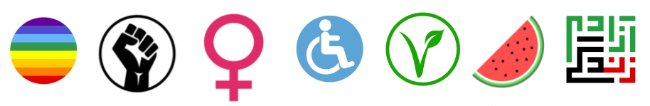

I'm an Associate Professor of Computer Science in the <a href="https://www.kth.se/cls">Department of Computing and Learning Systems (CLS)</a> at <a href="https://www.kth.se">KTH Royal Institute of Technology</a> in Sweden. I received my PhD in Computer Science from KTH in 2013, specializing in distributed systems. Following my doctoral studies, I worked as a postdoctoral researcher at the <a href="https://www.ri.se/en">Research Institutes of Sweden (RISE)</a>, where my research focused on data-intensive computing platforms. During my time at RISE, I also served as a guest lecturer at <a href="https://ce.aut.ac.ir/index.php?sid=4&slc_lang=en">Amirkabir University of Technology (AUT)</a> in Tehran from 2013 to 2015.  
 
In 2017, I joined the <a href="https://www.cs.ox.ac.uk/">University of Oxford</a> as a Machine Learning Scientist, where I worked until 2018 before returning to KTH as an Assistant Professor of Computer Science. I currently serve as the Program Director of the <a href="https://intra.kth.se/en/eecs/forskarutbildning/doctoral-programmes/information-and-communication-technology-1.817611">Information and Communication Technology (ICT)</a> doctoral program at the EECS School. I also lead the <a href="https://internal.wasp-sweden.org/ethical-legal-and-societal-aspects/">WASP Legal, Ethical, and Societal Aspects</a> cluster and am a member of the <a href="">WASP Diversity and Inclusion Group (DIG)</a>. 
 
My current research focuses on equity and justice in artificial intelligence, with a particular emphasis on large language models. To advance this work, I founded the <a href="https://co-liberative-computing.github.io/">Co-Liberative Computing</a> research group. Our goal is to foster critical consciousness in computer science research and education by recognizing that computing is not neutral but deeply intertwined with social, political, and economic structures. We investigate how digital technologies can reproduce or challenge existing inequalities and seek to integrate justice, equity, and social responsibility as core values in the design, development, and deployment of computing systems. 
<!-- 
At the core of our approach is the practice of co-liberation, grounded in the unwavering belief in a collective 'us.' This perspective recognizes the inseparable connection between our individual 
liberation and the imperative to collaborate for mutual freedom and the equitable redistribution of power. In the context of co-liberation, we advocate for a profound commitment to mutual benefit, 
underscoring the collective responsibility shared by both dominant and minoritized groups. Through these principles, we aspire to contribute to a transformative and inclusive computing landscape, 
addressing systemic injustices and fostering a society where technology serves as a force for positive change. This perspective challenges the conventional view of computing services as mere charity, 
reframing them as powerful tools for building meaningful relationships and addressing demographic disparities.-->

<!------------------------------------------------------------------>
<!-- Start of StatCounter Code for Default Guide -->

<noscript>

</noscript>
<!-- End of StatCounter Code for Default Guide -->

